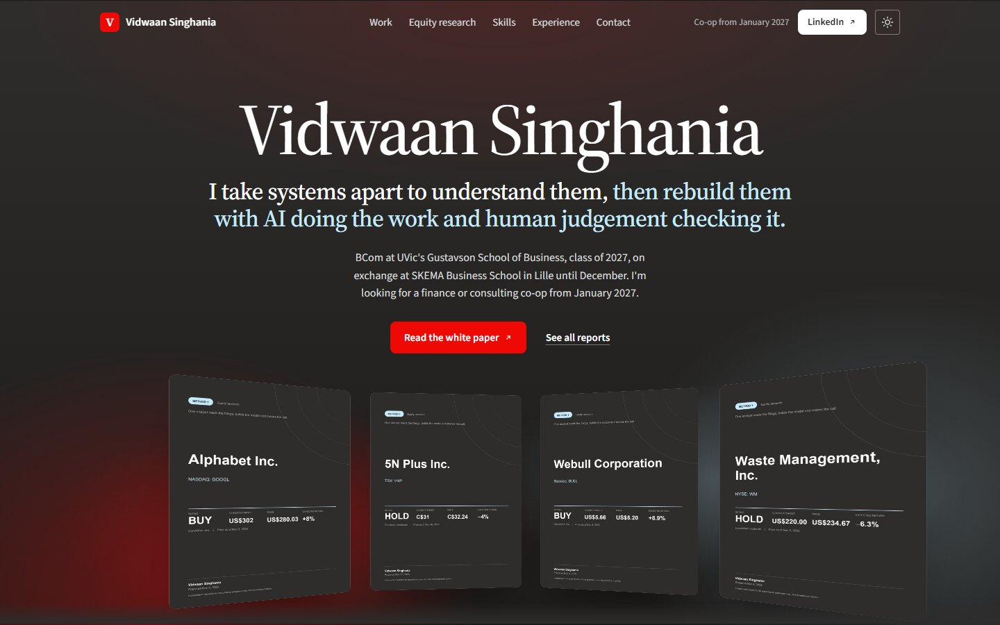

# vidwaansinghania.github.io

The personal website of Vidwaan Singhania, a BCom student at UVic Gustavson working in finance and consulting, with AI tools in both.

**[vidwaansinghania.github.io](https://vidwaansinghania.github.io/)**



## What's on the site

| Section | Contents |
|---|---|
| Intro | One line on what I do, and a 3D corridor of the report covers |
| Work | Multi-agent equity research shown with real pages from the reports and the white paper, plus the six-stock comparison; then sample reports, the I to E method and open-source AI skills |
| Equity research | A second page with every public report as a PDF: the Method 1 reports (one analyst) and the multi agent reports (ten agents), each with a cover page, a rating filter and a table of the companies both methods cover |
| Skills | Finance, consulting and technology skills, each paired with where it was used |
| Experience | Internships and paid roles, organizations founded and led, case competitions |
| Contact | LinkedIn |

## How it's built

- Plain HTML, CSS and a small script. No framework and no build step.
- The page is complete without JavaScript. With it, the report pages in the Work section spread apart as you scroll to them, and the nav marks the section you're reading. The motion is off for visitors who ask for reduced motion.
- Light and dark themes follow the system setting, with a toggle that remembers the visitor's choice.
- Fonts are subset and self-hosted, so the page makes no third-party requests.
- Served by GitHub Pages from the `main` branch.

```
index.html          the home page
equity-research.html  the equity research page
404.html            not-found page
about.html          redirect to /
experience.html     redirect to /#experience
assets/style.css    all styles; colour and type tokens are at the top
assets/main.js      report pages on scroll, section highlighting, theme toggle
assets/equity.js    rating filter on the equity research page
assets/fonts/       Source Serif 4, Source Sans 3 and JetBrains Mono, with their licences
assets/img/         portrait, photo, report page images, favicon, share card and the screenshot above
assets/img/er/      cover images for the reports
papers/             white paper and sample reports (PDF)
papers/equity-research/  the Method 1 and multi agent reports (PDF)
```

## Run it locally

```
python -m http.server 8000
```

Then open http://localhost:8000. Opening `index.html` straight from disk won't load the fonts.

## Credits and licence

Source Serif 4, Source Sans 3 and JetBrains Mono are under the SIL Open Font License; the licence texts are in `assets/fonts/`.

Site content and the PDFs in `papers/` are © 2026 Vidwaan Singhania. The reports are student research for educational purposes and are not investment advice.
